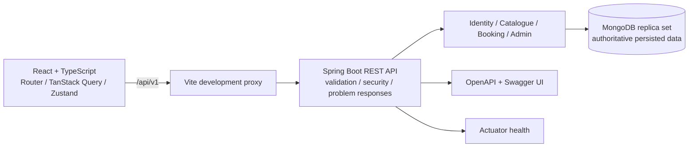
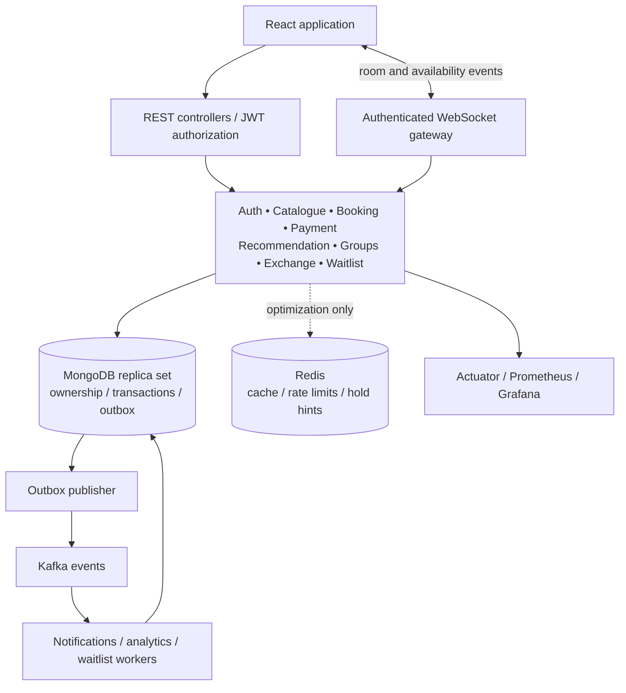
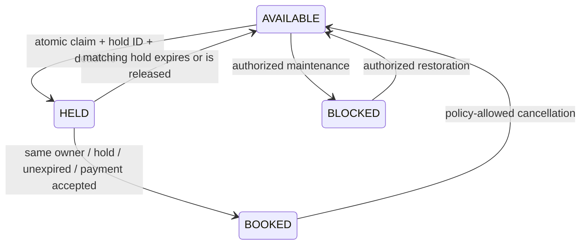

# CineNext architecture

## Current milestone

The catalogue is administrator-owned. Fresh startup creates no movies, cinemas or showtimes. Public reads require server-owned `catalogueSource: ADMIN` metadata, written within admin transactions. A startup migration adopts existing admin-audited records and dependencies of admin-created shows, while archiving unrelated demo records in place. Historical bookings/payments are retained. Demo fixtures are confined to test sources; production startup cannot seed a programme. Frontend empty states, featured film and city choices follow the public API without hardcoded catalogue items.

The current delivery is a working booking MVP: catalogue discovery, customer registration/login, USER/ADMIN authorization, selection of 1–8 seats, transactional holds, simulated payment, QR tickets, cancellation, booking history, and administration of movies/cinemas/showtimes. React calls Spring Boot; MongoDB persists accounts, inventory and business records. Selecting seats is local until Continue atomically acquires a server hold.

The dedicated native MongoDB replica set runs at 127.0.0.1:27018. Transactions use snapshot reads and majority writes. A hold lasts up to ten minutes, never beyond the start of the show. Every confirmation rechecks ownership and deadline. Availability polling runs every five seconds; expired holds appear available and can be reclaimed atomically without depending on a cleanup job.

Implemented packages are `identity`, `catalogue`, `booking`, `admin`, `config`, and `common`. Refresh rotation, manager scope, recommendations, collaborative rooms, exchanges, waitlists, Redis/Kafka, durable notifications and production observability remain future work.

The backend is a **Java 21 modular monolith**. A single deployable application keeps local development and multi-document transactions understandable. Domain packages, explicit service boundaries, and events provide room to grow without introducing distributed services prematurely.



The browser calls relative `/api` URLs. Vite forwards these requests to the Java server at `127.0.0.1:8080`; no database credentials enter the frontend. Production deployment must provide equivalent routing through a reverse proxy or configure an explicit permitted API origin. Development defaults bind local services to loopback.

## Target architecture — planned



Redis never decides who owns a seat. Kafka messages never turn an unsuccessful reservation into a successful one. Every state change is authorized and committed in MongoDB before an event is published.

### Domain boundaries

- **Identity:** users, password hashes, access tokens, rotating refresh sessions, roles, and cinema-manager scope.
- **Catalogue:** movies, theatres, screen layouts, showtimes, price schedules, and admin publication rules.
- **Booking:** seat availability, temporary holds, confirmation, cancellation, ticket versions, and booking history.
- **Payments:** simulated attempts, idempotent outcomes, reconciliation, and compensating refunds. Never accept an amount calculated only by the browser.
- **Recommendation:** pure Java scoring over a current availability snapshot; top-five explanations. The hold operation rechecks availability.
- **Groups:** rooms, invitation capabilities, member ownership, votes, allocations, and the all-paid policy.
- **Exchange:** ownership verification, request state machine, transactional swaps, ticket invalidation, and history.
- **Waitlist:** eligibility, FIFO ordering among matching entries, expiring offers, and idempotent allocation.
- **Notifications and analytics:** asynchronous projections that can be rebuilt from durable events; neither controls seat ownership.

Controllers translate transport DTOs; application services enforce rules; repositories express database predicates. Avoid sharing mutable MongoDB entities with browser request bodies. References between modules use IDs and deliberate service APIs.

## Booking consistency design

Each `(showtimeId, seatId)` has exactly one `show_seats` document. Its unique compound index prevents duplicate inventory rows; a conditional state transition prevents conflicting owners. A uniqueness constraint alone cannot prevent two different booking documents from claiming the same seat.



For a multi-seat hold, sort seat IDs, validate the showtime and server-side prices, and claim every requested seat in one bounded MongoDB transaction. Abort unless the matched count equals the requested count. Store the hold and idempotency result in the same transaction. Use a replica set with majority write concern; a local single-node replica set exercises transaction behavior, but does not demonstrate high availability. MongoDB supports atomic operations on one document and transactions when multiple documents must change together. [MongoDB transaction documentation](https://www.mongodb.com/docs/manual/core/transactions/)

Hold acquisition must require an available seat or a reclaimable expired hold, and confirmation must require the exact hold ID, owner, state, and `expiresAt > now`. All business times use a server-side `Clock` and UTC instants. Expiry workers and request-time checks use the same predicates. TTL deletion is delayed and only cleans retained records after the business transition; it does not release seats. [MongoDB TTL documentation](https://www.mongodb.com/docs/manual/core/index-ttl/)

Idempotency keys are scoped by actor and operation and paired with a canonical request hash. Repeating the same key and payload returns the original result. Reusing a key with different content is a conflict. Retry transient transaction failures with a bound; resolve an uncertain commit result before charging or retrying a different logical operation.

The initial payment implementation is simulated. Its success record and booking confirmation can be committed together. A future external gateway requires a separate payment state machine and reconciliation: a network call cannot participate atomically in a MongoDB transaction.

For exchange, lock by conditional booking/seat versions inside one transaction, swap both assignments, increase ticket versions, write audit/event records, and commit together. Old ticket QR versions must fail verification. There is no interval in which a seat has two valid owners.

## Security design

The current application exposes anonymous catalogue GETs, registration/login, documentation and health. Private booking resources enforce ownership, and every admin route requires ADMIN. Passwords use BCrypt cost 12. JWTs use a random configured HMAC secret, issuer validation and a 30-minute expiry. Access tokens stay in tab memory; logout clears the client session. Public registration always creates USER accounts. A local owner-operated command provisions a new admin and never promotes an existing user.

The local authentication limiter permits twenty attempts per remote IP per minute in one process. Shared rate limiting, account recovery, server-side token revocation and rotating refresh sessions are future hardening work. Future refresh cookies must use Secure/HttpOnly attributes and explicit CSRF/origin protections. Never put password hashes, payment secrets or bearer tokens in API responses or audit logs.

Current QR codes contain an opaque random ticket code. Admin verification looks it up and checks the current booking state and show timing. Cancellation immediately makes it invalid. Signed/versioned QR payloads for exchange and a one-time admission ledger are planned; a QR image itself is copyable.

Rate limits combine endpoint, principal, and trusted client-IP keys. Manager access is restricted to assigned theatres. Signed QR payloads contain an opaque booking ID, version, and expiry; admission verifies current server-side state. Duplicate scan handling is an explicit policy, not a claim that a static QR image is uncopyable.

## Recommended repository structure

```text
cinenext/
├── frontend/
│   ├── public/posters/           reusable original artwork themes
│   ├── src/
│   │   ├── components/          shared UI and seat preview
│   │   ├── pages/               route-level experiences
│   │   ├── lib/                 API client, types, formatting
│   │   └── stores/              browser preferences
│   ├── package.json
│   └── vite.config.ts
├── backend/
│   ├── src/main/java/com/cinenext/
│   │   ├── catalogue/           discovery, publication, migration and inventory
│   │   ├── identity/            registration, login, JWTs and accounts
│   │   ├── booking/             transactional holds, payments and tickets
│   │   ├── admin/               catalogue publication and ticket verification
│   │   ├── config/              security, clock, API configuration
│   │   └── common/              errors and shared transport helpers
│   ├── src/main/resources/      environment-based application settings
│   ├── src/test/                unit and integration tests
│   └── pom.xml
├── scripts/                     PowerShell bootstrap/run/check helpers
├── docs/                        architecture, schemas, API and roadmap
└── README.md                    exact commands and verification results
```

Folder names describe responsibility; the checked-in source tree is authoritative. Add `identity`, `booking`, `payment`, `recommendation`, `group`, `exchange`, and `waitlist` packages when those modules are implemented, rather than creating empty placeholders now.

## Principal risks and mitigations

- **Double selling:** conditional writes plus all-or-nothing transaction tests with independent concurrent clients.
- **Payment after expiry:** exact hold predicate, authoritative deadline, idempotent confirmation, and compensation for external payments later.
- **Dual database/event writes:** durable outbox in the business transaction; at-least-once publication and consumer deduplication by event ID.
- **Group partial payment:** all participants must pay before the hold deadline; otherwise release every seat and compensate successful simulated charges. Disconnecting never silently extends a hold.
- **Waitlist unfairness:** order eligible entries by `(createdAt, _id)`; allocate one offer transactionally and prevent simultaneous active offers for one entry.
- **Slow or failed dependencies:** finite timeouts, bounded retries, cache bypass, health indicators, and recoverable error UI.
- **Unreproducible performance claims:** retain workload, machine specification, commit, database configuration, raw metrics, and invariant checks alongside results.

No throughput number is promised before a reproducible measurement exists.
